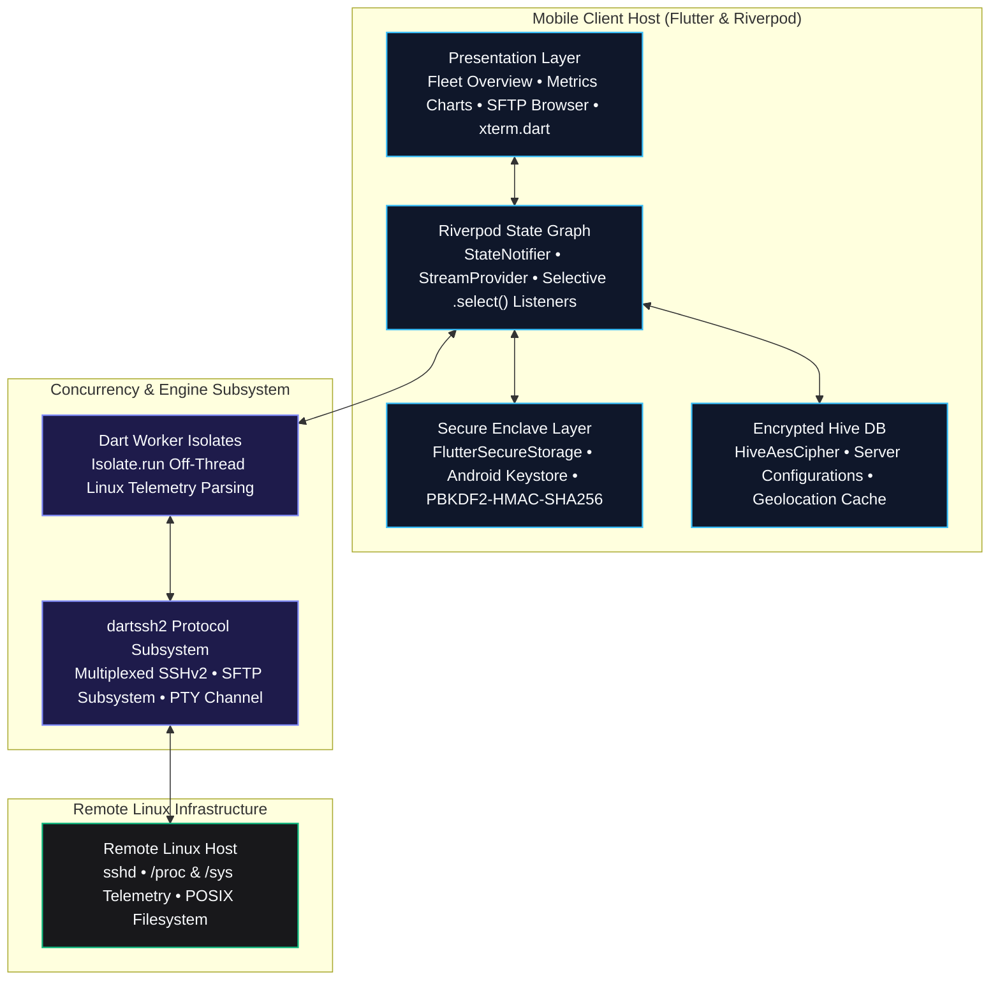

# Orbit

[](https://flutter.dev)
[](https://dart.dev)
[](https://github.com/yadukrishnan-h/orbit/releases)
[-3DDC84?logo=android&logoColor=white)](https://developer.android.com)
[-34A853?logo=android&logoColor=white)](https://developer.android.com)
[](SECURITY.md)

### *Your servers, always in sight. A production-hardened SSH terminal, SFTP browser, and real-time telemetry suite for Android.*

**Monitor real-time system metrics, explore remote filesystems via streaming SFTP, and execute interactive terminal commands — all directly from your mobile device with zero cloud telemetry or intermediary relay proxies.**

---

## Table of Contents

- [Overview](#overview)
- [System Architecture](#system-architecture)
- [Security Model](#security-model)
- [Key Features](#key-features)
  - [Real-Time Remote Telemetry](#1-real-time-remote-telemetry)
  - [Interactive VT100 / ANSI Terminal](#2-interactive-vt100--ansi-terminal)
  - [Streamed SFTP File Manager](#3-streamed-sftp-file-manager)
  - [Server Fleet Management & Operations](#4-server-fleet-management--operations)
- [Technology Stack](#technology-stack)
- [Local Development](#local-development)
  - [Prerequisites](#prerequisites)
  - [Installation & Setup](#installation--setup)
- [Security & Compliance](#security--compliance)
- [Star History](#star-history)
- [License](#license)

---

## Overview

Orbit is a Source-Available, mobile-first infrastructure client engineered specifically for Linux system administrators, DevOps engineers, and homelab enthusiasts. Built from the ground up using **Flutter** and **Dart**, Orbit pairs an ultra-low-latency SSH/SFTP engine (`dartssh2`) with a reactive, hardware-accelerated user interface.

Unlike traditional server managers that route traffic or metrics through proprietary cloud relays, Orbit functions on a **strict direct peer-to-peer architecture**:
- **Zero Intermediary Relays:** Your mobile device connects straight to your server's SSH daemon over raw TCP sockets.
- **Hardware-Backed Encryption:** Server credentials, private SSH keys, and the Master PIN hash reside in OS-managed hardware enclaves (Android Keystore / `EncryptedSharedPreferences`).
- **Complete Offline Resilience:** Orbit does not require an external account, internet connection, or third-party telemetry service to function.

---

## System Architecture

Orbit isolates high-frequency network socket I/O and telemetry text processing from the UI thread using background Dart Isolates and reactive Riverpod state machines:



### Architectural Highlights:
1. **Unidirectional Reactive Data Flow:** Riverpod state notifiers cleanly separate user intent from protocol execution.
2. **Selective Widget Subscriptions:** UI widgets subscribe using granular `.select()` expressions, eliminating cascading rebuild storms across unrelated dashboard widgets.
3. **Off-Main-Thread Processing:** Heavy Linux telemetry outputs are parsed within background worker Isolates, guaranteeing zero UI frame drops.

---

## Security Model

Orbit is engineered with a strict **private-by-design**, **offline-first** architecture:

- **Interactive TOFU Host Key Verification:** On first connection, Orbit displays the remote server's key type and OpenSSH SHA-256 fingerprint for verification. Keys are pinned to hardware-backed storage, and any key mismatch aborts the connection to defend against Man-in-the-Middle (MITM) attacks.
- **Hardware-Backed Master PIN:** Keys are derived using PBKDF2-HMAC-SHA256 (100,000 iterations) with constant-time verification. Progressive lockouts prevent brute-force attacks, with anti-tamper detection enforcing a 5-minute penalty lockout if the system clock is manipulated backward.
- **Two-Way Biometric Authentication Gate:** Biometrics can secure the app, and disabling biometrics requires authentication to prevent unauthorized disarming.
- **15-Second Background Auto-Lock:** Orbit automatically locks and terminates active SSH and SFTP sessions if the app remains in the background for 15 seconds or longer.
- **Android Screen & Snapshot Shield:** Release builds enforce Android `FLAG_SECURE` to prevent terminal scrollbacks, server addresses, and keys from leaking into Android Recents task previews or screen captures.
- **Zero Telemetry & Release Log Silencing:** Orbit includes zero third-party analytics trackers, and production release builds silence all debug logging to ensure zero credential or telemetry leakage in system logs.

---

## Key Features

### 1. Real-Time Remote Telemetry
- **Continuous Background Polling:** Continuous metric acquisition for CPU utilization, RAM usage, storage consumption, swap space, and uptime via `ServerMonitorViewModel`.
- **Adaptive Reconnect:** Resilient exponential-backoff reconnect engine (`[3, 5, 10, 20, 30]s`) with network awareness (`connectivity_plus`) that pauses on connection loss and auto-resumes when online.
- **High-Performance Visualizations:** Radial disk usage gauges, historical CPU line charts with dynamic min/max scaling (`fl_chart`), and danger-threshold status badges.
- **Encrypted Geolocation:** IP geolocation queries (`ipwho.is`) are cached inside an AES-256 encrypted Hive box (`geolocation_cache`) to minimize unnecessary network lookups.

### 2. Interactive VT100 / ANSI Terminal
- **Full PTY Terminal Emulation:** Powered by `xterm.dart` with support for ANSI color palettes, dynamic window resize signals (SIGWINCH), and xterm-256color environments.
- **Modifier Key Toolbar:** Dedicated, sticky **Ctrl** and **Alt** toggle buttons that map keystrokes to standard ASCII control characters (`0x00..0x1F`) or escape sequences (`\x1b`).
- **Native Clipboard Integration:** Instant clipboard paste button with automatic PTY input forwarding.
- **Split-Byte UTF-8 Streaming Resilience:** Implements stateful `Utf8Decoder(allowMalformed: true)` streaming across raw TCP chunks, completely preventing crashes on multi-byte UTF-8 character boundaries.

### 3. Streamed SFTP File Manager
- **OOM-Safe Chunked Streaming:** Large files are streamed directly between the SFTP socket and disk using Dart `IOSink`, preventing Out-Of-Memory crashes on multi-gigabyte transfers.
- **POSIX Shell Argument Sanitization:** Remote filesystem commands sanitize and escape shell arguments to neutralize command injection vulnerabilities.
- **Android 11+ Scoped Storage:** Native directory selection via `FilePicker.getDirectoryPath` and seamless file sharing via the Android system share sheet.
- **Comprehensive File Operations:** Directory navigation, search filtering, file rename, permission inspection, directory creation, and non-blocking background transfers.

### 4. Server Fleet Management & Operations
- **Quick Server Actions:** Instantly duplicate existing server configurations, trigger a remote reboot (`sudo reboot || reboot`), or initiate graceful server shutdown (`sudo poweroff || poweroff`).
- **Drag-to-Reorder:** Intuitive server reordering using individual drag handles with batch selection mode.
- **Multi-Authentication Methods:** Full support for password authentication, standard PEM/OpenSSH private keys, and passphrases.

---

## Technology Stack

| Layer | Component / Package | Version | Technical Role |
| :--- | :--- | :---: | :--- |
| **Framework Engine** | Flutter SDK | `^3.29.0` | Cross-platform UI toolkit and engine |
| **Language Runtime** | Dart SDK | `>=3.8.0` | Strongly typed asynchronous language runtime |
| **State Management** | `flutter_riverpod` | `^3.4.3` | Reactive, compile-safe dependency injection and state graph |
| **Declarative Router** | `go_router` | `^18.0.2` | URL-based routing with programmatic auth guard redirects |
| **SSHv2 / SFTP Engine** | `dartssh2` | `^4.1.0` | Pure-Dart cryptographic SSH, SFTP, and PTY socket implementation |
| **Hardware Keystore** | `flutter_secure_storage` | `^11.2.0` | Android Keystore & EncryptedSharedPreferences enclave storage |
| **Local Database** | `hive` / `hive_flutter` | `^2.2.3` | AES-256 encrypted NoSQL box storage for telemetry and servers |
| **Cryptography** | `cryptography` | `^2.7.0` | Cryptographic PBKDF2-HMAC-SHA256 Master PIN derivation |
| **Terminal Emulator** | `xterm` | `^4.0.0` | VT100 / ANSI terminal emulation and ANSI rendering |
| **Charts & Gauges** | `fl_chart` | `^1.1.1` | High-performance hardware-accelerated telemetry charts |
| **Biometrics** | `local_auth` | `^3.0.1` | Native biometric prompt integration |
| **Connectivity** | `connectivity_plus` | `^7.0.0` | Network status monitoring for automatic reconnects |
| **Storage & Pickers** | `file_picker` / `path_provider` | `^13.1.0` / `^2.1.3` | Scoped storage access and native directory pickers |

---

## Local Development

### Prerequisites
- **Flutter SDK**: `3.29.0` or higher (`flutter --version`)
- **Dart SDK**: `3.8.0` or higher (bundled with Flutter)
- **Java Development Kit**: JDK 17 (required for Android Gradle Plugin 8.11+)
- **Android SDK**: Build-Tools `35.0.0`, Platform SDK `android-35`

### Installation & Setup

1. **Clone the repository:**
   ```bash
   git clone https://github.com/yadukrishnan-h/orbit.git
   cd orbit
   ```

2. **Install project dependencies:**
   ```bash
   flutter pub get
   ```

3. **Generate code artifacts (Freezed models & JSON serializers):**
   ```bash
   dart run build_runner build --delete-conflicting-outputs
   ```

4. **Run the application locally:**
   ```bash
   flutter run -d <device_id>
   ```

---

## Security & Compliance

Orbit treats user infrastructure security as a zero-compromise requirement. If you discover a potential vulnerability, please review our [SECURITY.md](SECURITY.md) for responsible disclosure guidelines. Do not open public GitHub issues for security vulnerabilities.

---

## Star History

<a href="https://www.star-history.com/?repos=yadukrishnan-h%2Forbit&type=timeline&releases=&legend=bottom-right">
 <picture>
   <source media="(prefers-color-scheme: dark)" srcset="https://api.star-history.com/chart?repos=yadukrishnan-h/orbit&type=timeline&theme=dark&legend=bottom-right" />
   <source media="(prefers-color-scheme: light)" srcset="https://api.star-history.com/chart?repos=yadukrishnan-h/orbit&type=timeline&legend=bottom-right" />
   
 </picture>
</a>

---

## License

This software is released under a **Source-Available** license. You may inspect, build, and modify the code for personal, non-commercial use. Commercial distribution, redistribution, or publishing to app stores is strictly prohibited without explicit written permission.

See [LICENSE](LICENSE) for full licensing terms.